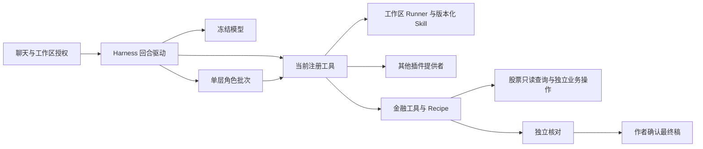

# 插件权限与金融研究

| 调用路径 | 实际约束 | 归属 |
| --- | --- | --- |
| 能力栏 → 工作区目录 → 本轮技能快照 | 选择影响发现范围，方法正文按固定版本读取。选中、读取以及模型请求实际包含正文分别核验 | 宿主、Runner |
| 模型 → 注册表 → 工具路由 → 提供者 | 每次执行核对工作区、云访问、写权限及提供者状态。源文件与脚本使用原工作区环境 | Harness、Core |
| 作者 → 单层批次 → 角色执行器 | 必需工具缺少时指明名称，可选工具可以缺席。继承与任务的 tool_scope 取交集。禁止子任务再次委派或发布 | Harness |
| 作者 → 研究会话 → Recipe → 核对 → 发布 | 新工作单可指定阶段需要的角色。采信摘录和计算需要登记；作者带匹配当前版本的回执明确发布 | 金融插件 |
| 作者或角色 → 行业成分查询 → 股票服务 | 只读当前数据源覆盖的范围，观察时间与行情交易日分开。异步筛选另有提交工具 | 股票仓库 |
| 页面 → 已登记服务 → 唯一启动器 | 金融兼容 URL 的鉴权和行为由金融路由提供。退出调用服务适配器，等待确认后关闭 | BFF、插件、启动器 |

普通回合和金融回合共用 Harness 回合调度、模型流收尾和 Core 工具回执执行。金融回合的请求准备、来源展示以及历史兼容逻辑仍在 `plugins/finance/loop.py`。其中 `FinanceLoop.run` 供直接调用策略的旧用例使用；生产通过 `Agent.run` 驱动。迁移这些用例后可移除兼容入口。

显式封闭材料比较由 `brief_comparison.requested` 识别。金融程序自动保存来源时沿原工具授权。账户、后台任务及修改旧 Skill 的直接接口不作为研究角色的可委派操作。选中来源或方法不能扩大云读写授权。缺角色成果、缺原件、工具拒绝和模型终态未知各自保留原回执。

| 兼容入口 | 现有调用方 | 保留或移除条件 |
| --- | --- | --- |
| `ToolRouter.research` | BFF 的会话绑定、历史回放和直接构造研究会话的测试 | 属性把提供者的执行范围交给路由。调用方全部改用回合上下文后可移除属性 |
| `brief_publish` 首次返回 `REVIEW_READY` | 原作者提示、沿用现有工具的会话 | 对应生成契约仍受支持时保留。正式发布仍须作者提交匹配回执 |
| 原股票 HTTP URL | 股票服务、工作台、历史报告读者 | 客户端沿用原 URL；路由实现和服务关闭均由已登记的金融提供者承担 |
| 创建时冻结的 Recipe 与角色 | 旧研究阅读器、开发者离线回放 | 按原契约解释档案，修改新角色声明时不改写历史研究 |

### 受信能力管理

宿主页面对一个工作区、一种包、一个 ID 核准发布者公钥、允许的操作及权限。模型工具 `capability_package` 只能在这份授权内运行。宿主插件安装、升级和卸载经原包队列及下次冷部署；工作区 Skill 使用 Runner 的内容寻址版本。激活后新的回合能读取新版本，正在执行的回合沿用原快照。

签名使用 Ed25519。被签字节依次为 `local-ai-agent/package/v1`、包身份和版本 SHA-256，每行以 LF 结束。插件身份为插件 ID，技能身份为 `skill/<name>`。权限增加须重新授予；签名或内容校验失败会返回错误。旧版的人工确认仍只绑定被确认的版本。

### 离线核验

使用 `tests.test_cross_plugin_scope` 核对新工具发现、停用、云读写和单任务收窄，`tests.test_package_authority` 核对真实签名与部署状态。完整回归运行 `python -m tests.run_offline`。金融候选稿被脚本修改后，仍须按当前内容与证据指纹重新取得核对资格。独立核对中断保留旧回执与草稿。
